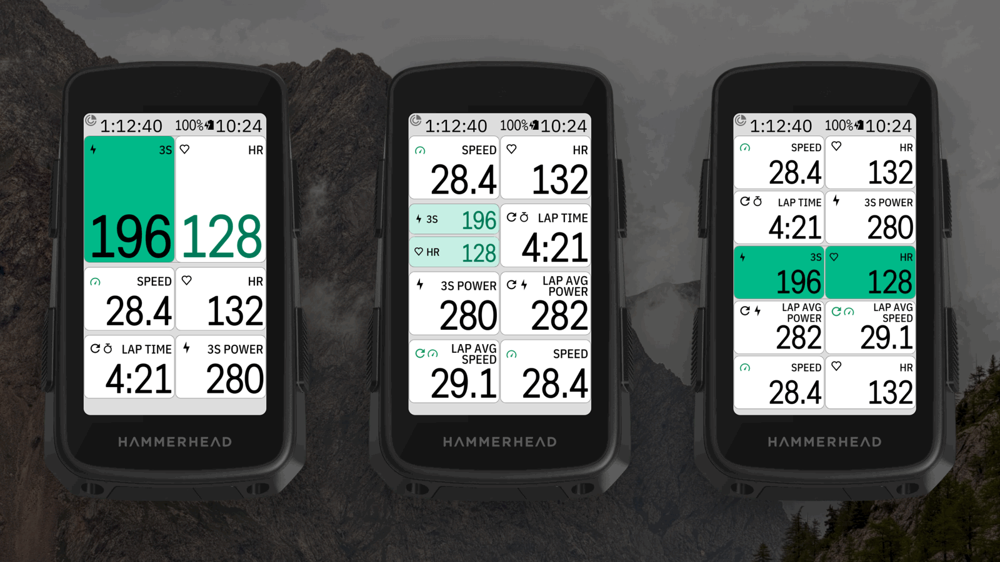
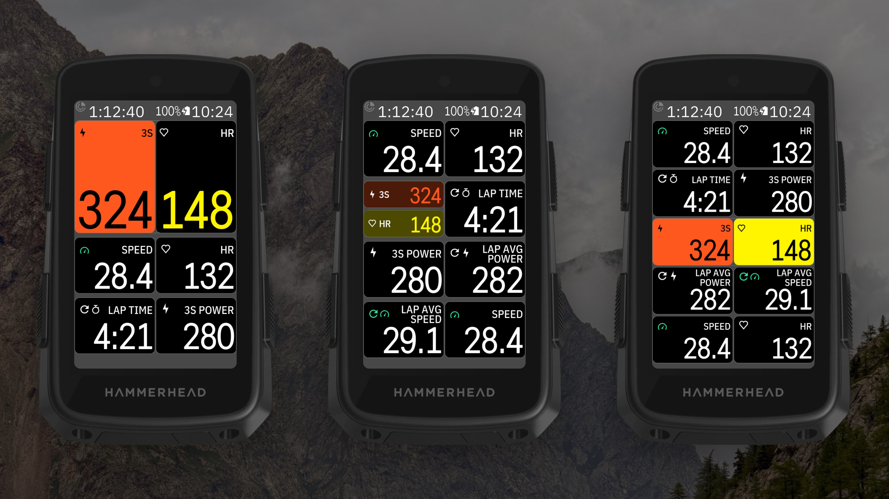
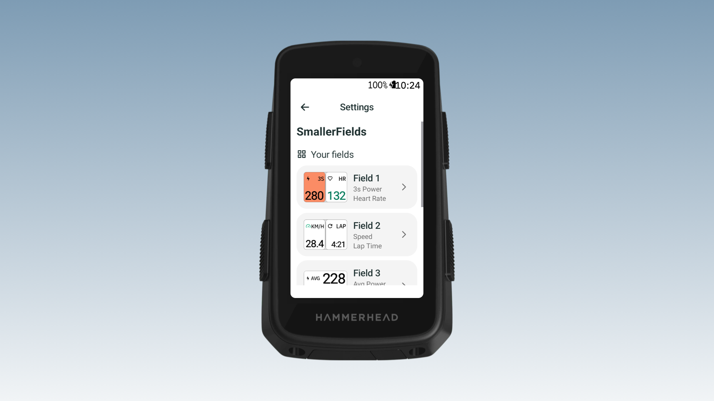
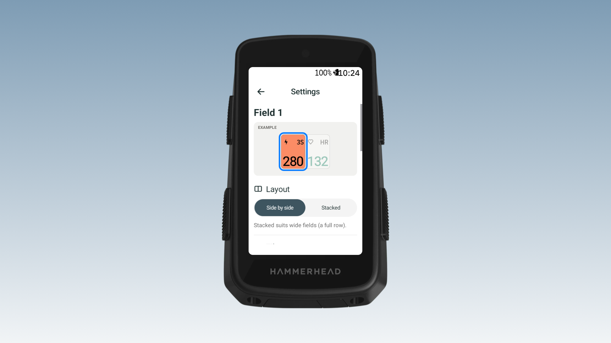
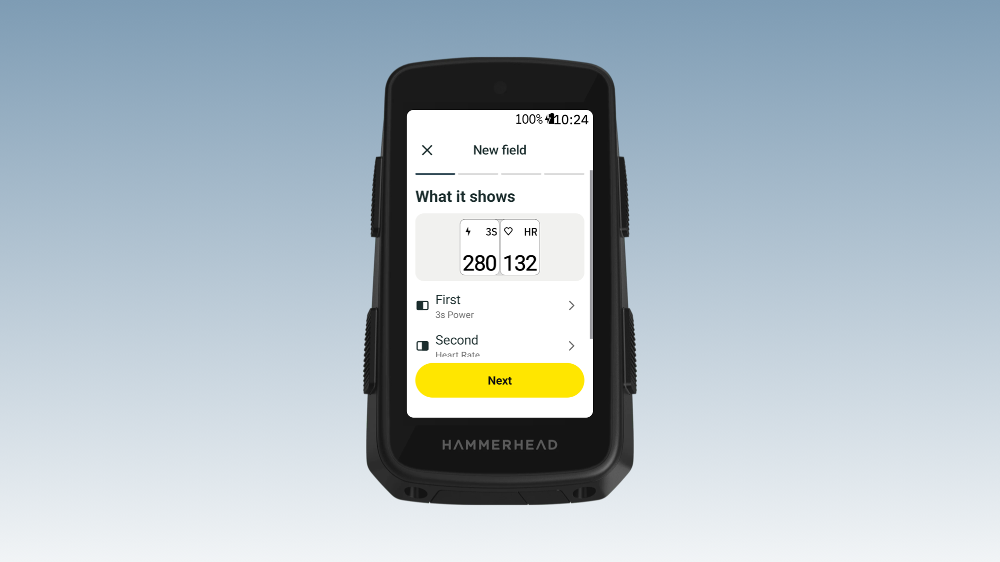

<!-- docs.sh: generated from docs/app.yml. Edit that file and run setup/docs.sh, not this block. -->
<a href="https://buymeacoffee.com/Dubadai"></a>

# SmallerFields for Karoo 3

Listed on the Karoo as **DDB SmallerFields**, next to the other DDB apps.

Two data fields in one Karoo tile, in the Karoo's own style: icon, short label and number for
each, smaller. Shown on the Karoo as **DDB SmallerFields**.




- **Up to ten fields** (Field 1–10 under DDB SmallerFields), each with its own two data, so one ride page can hold several.
- **Data:** power (now, 3s, 10s, average, NP, lap), heart rate (now, average, lap), cadence, speed
  (now, average), distance, ride time, lap time, ascent, grade. In your units.
- **Short labels, icons say the rest:** 3s power is the bolt and `3S`, lap time is `LAP`, speed
  shows `KM/H` or `MPH`.
- **Layout:** side by side or stacked.
- **Tiles:** separate (two small Karoo tiles) or single (one tile, a line between). Follows the
  Karoo's *Data field boundaries* setting: with it off there are no cards and no line.
- **Zone colours** for power and heart rate, the Karoo's own, from your rider profile:
  number in black/white or the zone colour; background none, Karoo (strong) or soft.

## Install on your Karoo

1. On your phone, open the [latest release](https://github.com/Dubadai/karoo-smallerfields/releases/latest)
   and share the `smallerfields.apk` link to the **Hammerhead Companion** app (or with a computer:
   `adb install smallerfields.apk`).
2. Open **DDB SmallerFields** from the Karoo's app list and press **+ Add field**. It ends by
   telling you the field's name (Field 1, Field 2…).
3. In a ride profile, add **DDB SmallerFields → Field 1** (or the name it gave you) to a page.

Values show `--` while a sensor isn't connected. Zone colours need power and heart rate zones in
your Karoo rider profile. Problems or ideas: [Issues](https://github.com/Dubadai/karoo-smallerfields/issues).

<!-- /docs.sh -->

## Settings

Open **DDB SmallerFields** from the Karoo's app list. **Add field** walks you through what it
shows, layout, tiles and colours, then tells you its name (Field 1, Field 2…): that's what you
pick on the Karoo (a ride page › a field › DDB SmallerFields). Tap a field in the list to change
or delete it. A field you add to a page before making it says "Not set up yet".

  

## Build

```bash
export JAVA_HOME="/Applications/Android Studio.app/Contents/jbr/Contents/Home"
./gradlew -q assembleDebug
```

Debug and release builds show only real data (test with the FakeWatts sensor). Mockups without a Karoo:
`bash ../design-assets/tools/field-gallery/gallery.sh karoo-smallerfields`.

Design history: `docs/design/`.
